<div align="center">

#  Gitread.me

**A native Android app for reading Markdown from GitHub repositories or your device, with a focused reader and offline support.**


</div>

---

## Table of contents

1. [What is Gitread.me?](#what-is-gitreadme)
2. [Who is it for?](#who-is-it-for)
3. [Feature overview](#feature-overview)
4. [Quick start](#quick-start)
5. [User guide](#user-guide)
6. [How it works](#how-it-works)
7. [Architecture](#architecture)
8. [Data and storage](#data-and-storage)
9. [Security and privacy](#security-and-privacy)
10. [Technology stack](#technology-stack)
11. [Project structure](#project-structure)
12. [Build, run and test](#build-run-and-test)
13. [Troubleshooting](#troubleshooting)
14. [FAQ](#faq)
15. [Known limitations](#known-limitations)
16. [Contributing](#contributing)
17. [License](#license)

---

## What is Gitread.me?

Gitread.me is an Android app that makes reading documentation on GitHub pleasant on a phone. Documentation lives in Markdown files across thousands of repositories, but the mobile browser experience is often cramped and requires a connection. Gitread.me fixes both:

- It **browses a repository's Markdown files** the way a file manager would.
- It **renders them in a clean, customizable reader** with search, a table of contents, bookmarks, and PDF export.
- It can **save a repository's Markdown on your device** so you can read it with no network.
- It talks **directly to GitHub's REST API**. There is no app server, no analytics backend, and no account to create.

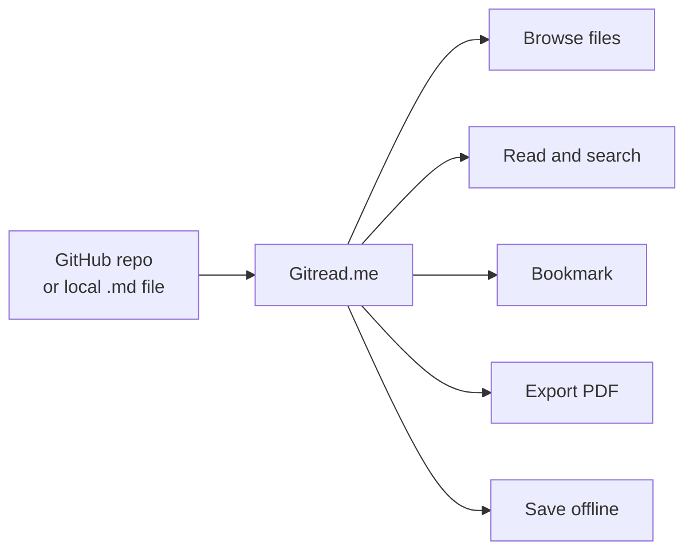

## Who is it for?

| You are... | Gitread.me helps you... |
|---|---|
| A student or learner | Read course notes and tutorials kept in GitHub repos, even without internet |
| A developer | Skim project docs and READMEs on the go |
| A technical writer | Check how docs render, and export a doc to PDF |
| Someone with private repos | Read private docs using a read-only fine-grained token |

---

## Feature overview

### 🔎 Find and open documents

- Open a public repository by entering `owner/repository`, pasting a GitHub URL, or using a supported GitHub SSH URL.
- Open a repository, branch, folder, or Markdown file from a GitHub `tree` or `blob` URL.
- When signed in, browse repositories available to the authenticated GitHub account.
- Browse Markdown files in folders, filter paths by name, switch branches, and manually refresh repository data.
- Open a local `.md` or `.markdown` file through Android's document picker or an app's **Open with / Share** action. The app copies the selected file into its private app storage before displaying it.
- See recently opened GitHub and local documents on the home screen.

### 📚 Read Markdown

- Renders headings, paragraphs, emphasis, links, images, fenced and indented code, block quotes, ordered and unordered lists, thematic breaks, and tables.
- Supports GitHub-Flavored Markdown: tables, strikethrough, task lists, and autolinks.
- Centered, readable document column with serif reading typography, monospace code, syntax color accents, and horizontally scrollable code and tables.
- Light, dark, or app-following reader appearance, independent of the app theme.
- Reader font size from **12 sp to 28 sp**.
- Case-insensitive search with highlighted matches and next/previous navigation.
- Table of contents and heading-link navigation.
- A subtle right-edge scrubber for quickly moving through long rendered documents; it fades away after scrolling and shows the current section while dragging.
- Bookmark GitHub or local documents, optionally select and copy rendered text (controlled in Settings), copy a code block or the full Markdown source, and toggle between rendered and raw Markdown.
- Export the rendered document to PDF, or share a generated PDF.
- Restores the last reading position for each document.

### 📴 Keep repositories available offline

- From **Open from GitHub**, open a repository's three-dot menu and choose **Make available offline**.
- Or use the download action in **Settings → Manage saved repositories**.
- The app downloads every Markdown document listed in the repository's saved tree, with progress and a completion summary.
- **Bookmarks → Offline repos** shows repositories whose current Markdown file list is fully cached.
- Cached documents open without a network connection. Refresh manually when online to pick up changes.

> **Note:** Offline availability covers Markdown **text only**. Repository assets, remote images, external links, and PDFs are not downloaded.

### ⚙️ Settings and backup

- App theme: system, light, or dark.
- Reader appearance: follow app, light, or dark; optionally enable or disable text selection in rendered Markdown.
- Persistent reader font size.
- Sign in with a GitHub fine-grained personal access token for private repositories and higher API rate limits.
- Export or import a JSON backup containing the app theme, reader appearance, font size, rendered-text selection preference, and bookmarks.

> Backups intentionally **exclude** access tokens, cached documents, repository contents, local-file bookmarks, and reading positions. Supported reader and theme settings are included. To restore GitHub bookmarks, first save the corresponding repositories and branches on the destination device. Import then adds bookmarks for the repositories it can match.

---

## Quick start

### What you need

| Requirement | Details |
|---|---|
| Android Studio | With Android SDK Platform 36 and Build Tools installed |
| JDK | 17 or newer (Gradle must run on 17+; the app's bytecode target stays 17) |
| Gradle | 8.11.1, only if generating the missing wrapper scripts |
| Device | Android 8.0 (API 26) or newer, physical or emulator |

### Run it in Android Studio

1. Open the repository root in Android Studio.
2. Set **Gradle JDK** to 17 or newer. Install Android SDK Platform 36 if prompted.
3. Sync the project.
4. Pick the `app` run configuration and a device or emulator, then press **Run**.

### Run it from the command line

The repository does **not** currently include `gradlew` or `gradlew.bat`. Generate the wrapper scripts once (requires Gradle 8.11.1 installed):

```powershell
gradle wrapper --gradle-version 8.11.1
```

Then build and install:

```powershell
# Windows PowerShell
.\gradlew.bat :app:assembleDebug
.\gradlew.bat :app:installDebug
```

```sh
# macOS / Linux
./gradlew :app:assembleDebug
./gradlew :app:installDebug
```

The debug APK is written to `app/build/outputs/apk/debug/`.

---

## User guide

### Opening GitHub content

1. Tap the **GitHub icon** on the home screen.
2. Paste a repository URL or type `owner/repository`. If you are signed in, you can instead pick a repository under **Your repos**.
3. Browse folders and Markdown files. Use the **search icon** to filter the saved file list.
4. Use the repository menu to **switch branches** or **refresh** the saved tree.
5. Open a file to read it. Its contents are cached automatically if the document is within the size limit.

**Accepted input formats**

```text
octocat/Hello-World
https://github.com/octocat/Hello-World
https://github.com/octocat/Hello-World/tree/main/docs
https://github.com/octocat/Hello-World/blob/main/README.md
git@github.com:octocat/Hello-World.git
```

> **Branch names with `/`:** these cannot always be told apart from a path in a pasted `tree` or `blob` URL. If a URL cannot be parsed unambiguously, open the repository and switch branches inside the app.

### Reading a document

| Action | Where |
|---|---|
| Search the document | Reader toolbar → search |
| Jump to a heading | Reader toolbar → table of contents |
| Bookmark | Reader toolbar → bookmark icon (GitHub documents only) |
| Rendered / raw view | **More options** |
| Copy Markdown or a code block | **More options** / code block copy button |
| Change font size | **More options** (also in Settings) |
| Refresh the document | **More options** |
| Export or share PDF | **More options** |
| Open on GitHub | **More options** |

Defaults: the reader starts in **dark** appearance at **16 sp**.

### Making a repository available offline

1. Open **Open from GitHub** and find the repository under **Your repos**.
2. Tap its **three-dot menu** and choose **Make available offline**.
3. **Keep the app open** while it downloads. The row shows progress, and a final message reports how many files were downloaded, already cached, or unavailable.
4. Open **Bookmarks → Offline repos** to see repositories whose full, current Markdown list is cached.

The same action is available in **Settings → Manage saved repositories**. Repository tree metadata must already be saved. Opening a repository from GitHub creates it.

**For the freshest offline copy:** refresh the repository while online, *then* run **Make available offline**.

### Opening a local Markdown file

1. On the home screen, choose the local file option.
2. Pick a `.md` or `.markdown` file in Android's document picker, or choose Gitread.me from another app's **Open with / Share** menu.
3. The app copies it to its private storage (`files/local_docs/`) and opens it.

Local files do not appear in GitHub reading history and cannot be bookmarked.

### Signing in for private repositories

1. On GitHub, create a **fine-grained personal access token** with the narrowest scope possible:
   - **Contents: read-only**
   - **Metadata: read-only**
   - Restricted to only the repositories you need.
2. In Gitread.me, go to **Settings** and submit the token.
3. The app validates it with GitHub and stores it encrypted.
4. Your private repositories now appear under **Your repos**.

Signing out clears the token **and deletes saved private repositories** (with their cached documents, bookmarks, and history).

### Backing up and restoring

1. **Settings** → export a JSON backup to a location you choose.
2. On a new device, first open and save the repositories and branches your bookmarks refer to.
3. **Settings** → import the JSON backup. Bookmarks are restored for the repositories it can match.

---

## How it works

### Opening and browsing a repository

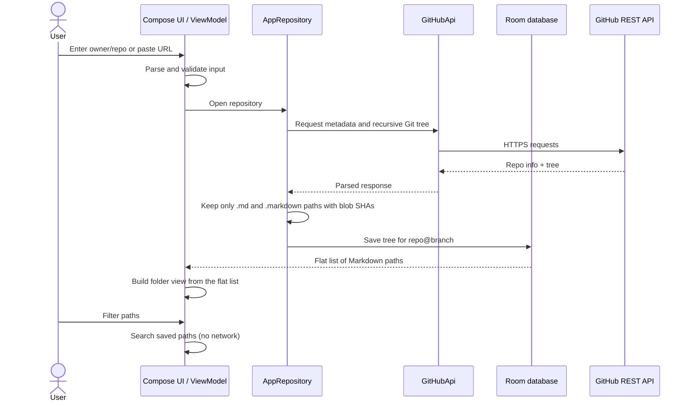

Step by step:

1. The input parser validates `owner/repository` and extracts an optional branch and path from supported URLs.
2. The app requests repository metadata and its **recursive Git tree** from the GitHub REST API.
3. Markdown paths (`.md` and `.markdown`, case-insensitive) and their **blob SHAs** are saved locally per repository and branch.
4. Folder listings are built from this flat path list. Filtering searches the saved paths with **no extra network request**.

### Opening a document: cache decision

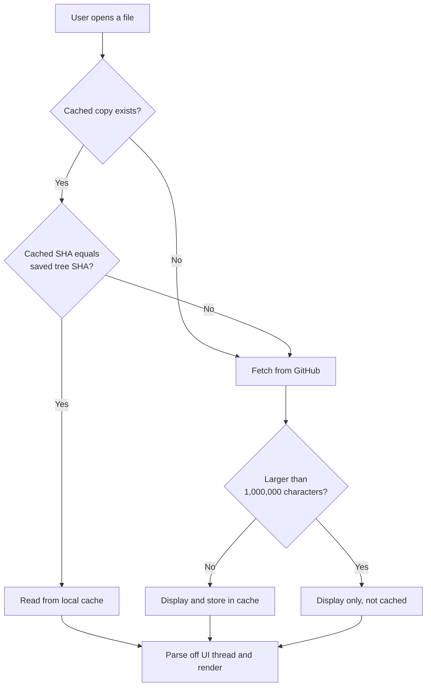

### Refreshing a repository

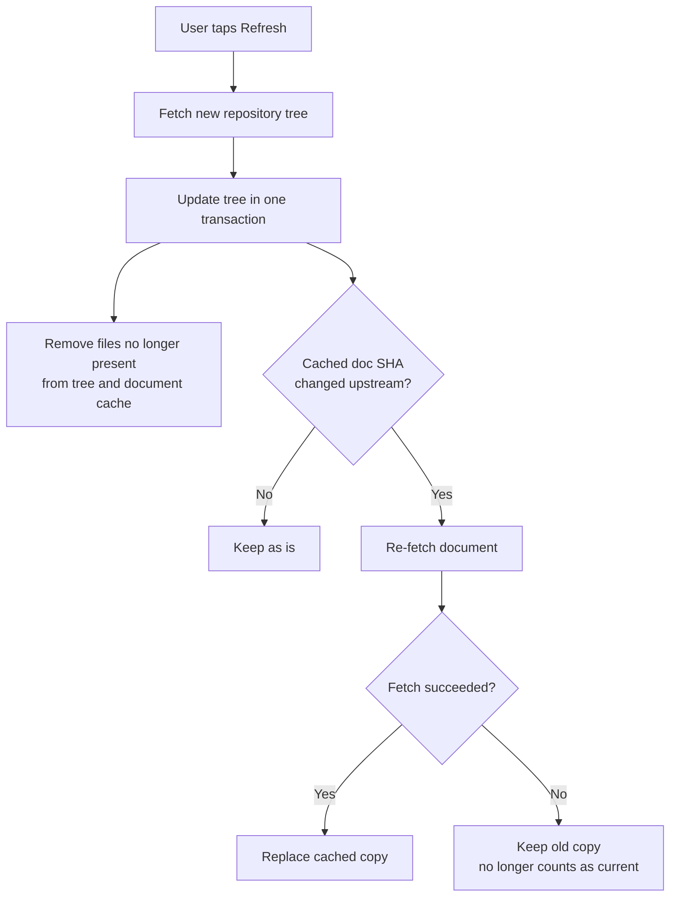

A refresh can update the saved tree even if fetching one changed document fails. The older copy is retained, but it is no longer considered current for the **Offline repos** list.

### Making a repository available offline

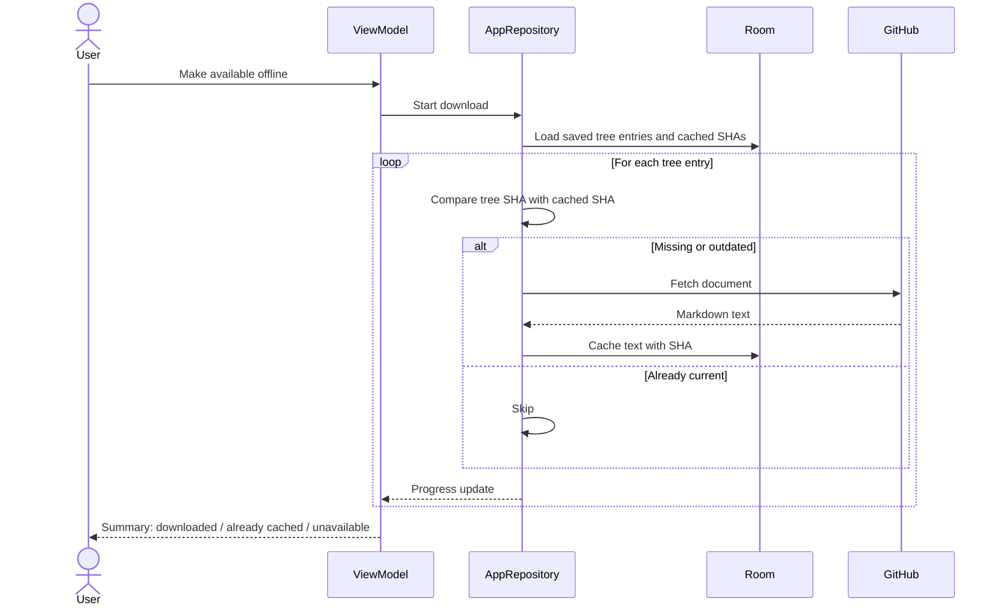

Important behavior:

- Downloads run **while the screen's ViewModel is alive**. They are not scheduled as background work and may stop if Android kills the app or the screen process.
- Documents over **1,000,000 characters** are skipped for the cache.
- A repository appears in **Offline repos** only when it has at least one Markdown document **and every** Markdown file in its saved tree has a cached document with a matching SHA. A partial download is never shown as offline-ready.

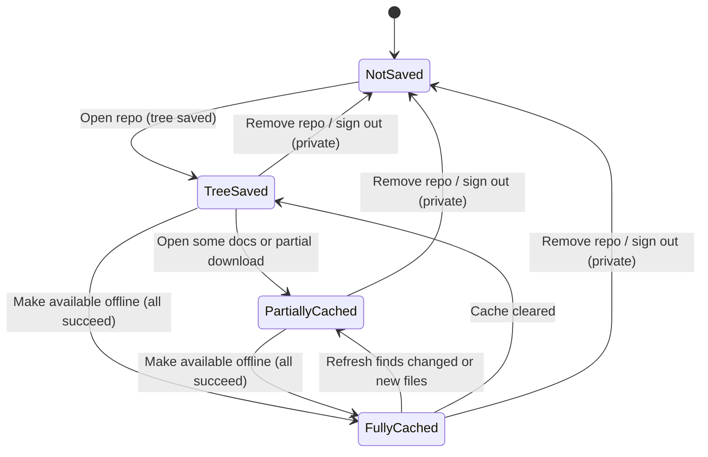

> Only **FullyCached** repositories are listed under **Bookmarks → Offline repos**.

### Reading and saved position

- GitHub documents are parsed **off the UI thread**, then rendered as a **lazy list of Markdown blocks**.
- Search highlights matches and scrolls to the matching block.
- The table of contents and same-document heading links scroll to the corresponding heading.
- Scroll position is saved per repository/document (or local file) in Android DataStore and restored the next time it is opened.
- Local `.md` files are copied to the app's private `files/local_docs` directory before opening. They appear in recent documents and can be bookmarked on this device. Local file bookmarks are excluded from backups because their app-private paths are not portable to another device.

### Authentication flow

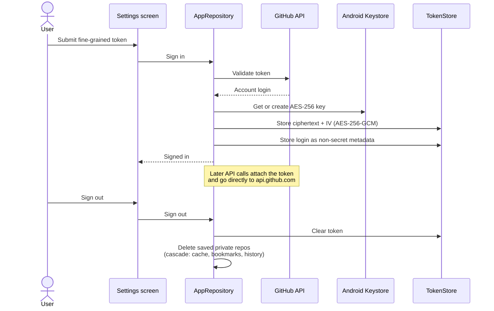

---

## Architecture

### Layered overview

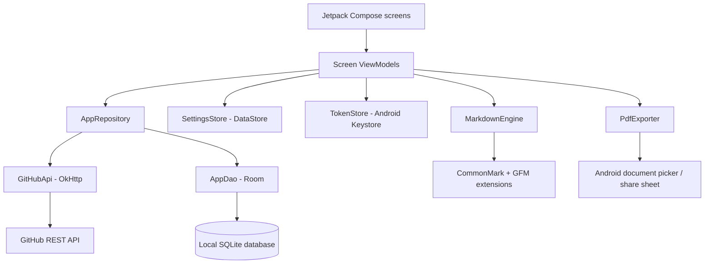

### Responsibilities

| Component | Package | Responsibility |
|---|---|---|
| **Compose UI** | `ui/` | Screens, interaction state, navigation, Markdown presentation |
| **ViewModels** | `ui/` | Screen-level state and coroutine work; connect UI events to the repository or settings |
| **`AppRepository`** | `data/` | Repository lifecycle, cache policy, synchronization, bookmarks, history, authentication state |
| **`GitHubApi`** | `data/` | Read-only GitHub REST calls using OkHttp and Kotlin serialization |
| **Room** (`AppDatabase`, `AppDao`) | `data/` | Persistent repository metadata, Markdown tree, cached text, bookmarks, reading history |
| **`SettingsStore`** | `data/` | Theme, reader appearance, font size, scroll positions (Preferences DataStore) |
| **`TokenStore`** | `core/` | Encrypted token storage with Android Keystore and AES/GCM |
| **`MarkdownEngine`** | `core/` | Parser abstraction. `CommonmarkEngine` converts CommonMark/GFM nodes into UI-independent Markdown models |
| **Reader UI** | `ui/` | Turns Markdown models into Compose blocks; resolves links, images, search, and table-of-contents navigation |
| **`PdfExporter`** | `core/` | Paginates a Markdown model into a local PDF using Android's `PdfDocument` APIs |
| **`AppContainer`** | app | Small manual dependency-injection container created by the `Application` class. **No DI framework** is used |
| **Domain helpers** | `domain/` | Path listing, filtering, and relative-link resolution |

### Markdown rendering pipeline

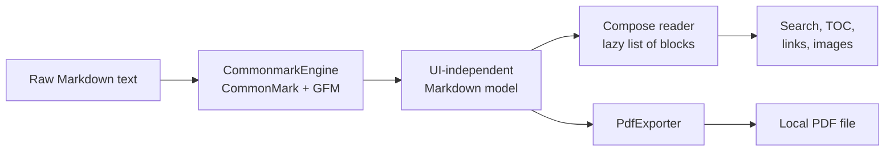

Because the parser output is UI-independent, the same model feeds both the on-screen reader and the PDF exporter.

---

## Data and storage

### Entity relationships

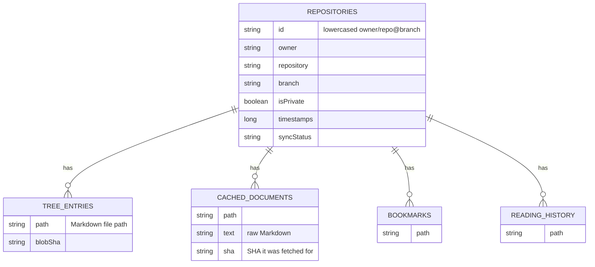

> The diagram shows the relationships. Exact column names live in the exported schema under `app/schemas/`.

| Table | Purpose |
|---|---|
| `repositories` | Owner, repository, branch, privacy flag, timestamps, and sync status. |
| `tree_entries` | Markdown file paths and Git blob SHAs for a repository branch. |
| `cached_documents` | Raw Markdown text and the SHA it was fetched for. |
| `bookmarks` | Bookmarked GitHub and local documents. |
| `reading_history` | Recently opened GitHub and local documents. |

**Repository ID** = lowercased `owner/repository` + `@branch`. Each branch is cached **independently**. Tree entries, documents, bookmarks, and history reference the repository through **cascading foreign keys**, so deleting a repository removes everything attached to it.

### Where everything is stored

| Data | Location | Notes |
|---|---|---|
| Repo metadata, tree, cached Markdown, bookmarks, history | Room database `mdreader.db` | Schema version 1 |
| App theme, reader appearance, font size, rendered-text selection, reading positions | Preferences DataStore (`settings`) | |
| Encrypted token (ciphertext + IV) and GitHub login | Auth preferences | Login is non-secret metadata |
| Token encryption key | Android Keystore | Never leaves secure hardware or system keystore |
| Local Markdown files | `files/local_docs/` | App-private storage |
| Backup JSON | Location you pick via document picker | Theme, reader appearance, font size, rendered-text selection, bookmarks only |

- Kotlin **2.0.20**, Android Gradle Plugin **8.10.0**, Gradle **8.11.1**
- Jetpack Compose and Material 3; Compose BOM **2024.09.00**
- AndroidX Navigation Compose, Lifecycle ViewModel/StateFlow, and Kotlin Coroutines
- Room **2.6.1** with KSP; Preferences DataStore **1.1.1**
- OkHttp **4.12.0** and Kotlin serialization JSON **1.7.2**
- CommonMark **0.21.0** with GFM tables, strikethrough, task lists, and autolinks
- Coil **2.7.0** with SVG decoding
- Android `PdfDocument` for PDF export

Android configuration: **min SDK 26**, **target SDK 36**, **compile SDK 36**, Java/Kotlin bytecode target **17**, app version **1.0.0**.

### Database migrations

The database is **schema version 1**. Any schema change must:

1. Increment the Room database version.
2. Add a **non-destructive** migration.
3. Update the exported schema in `app/schemas/`.

The app does **not** enable destructive migration fallback.

---

## Security and privacy

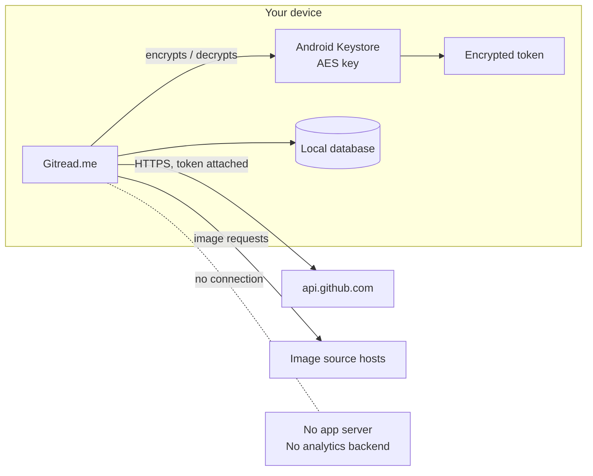

- **No backend.** API calls go directly from the app to `api.github.com`. The token is never sent to a separate application server.
- **Token encryption.** The token is encrypted with **AES-256-GCM**. The key is held by **Android Keystore**.
- **Least privilege.** Use a fine-grained token with only **Contents: read-only** and **Metadata: read-only**, limited to the repositories you need.
- **Backups exclude secrets.** Exported JSON never contains tokens, cached documents, repository contents, or reading positions.
- **Automatic Android backup is disabled** in the manifest. Use the explicit JSON backup for supported settings and bookmarks.
- **Public browsing needs no sign-in**, subject to GitHub's unauthenticated API rate limits.
- **Images load from their source.** Markdown images may point to GitHub or external hosts. They are fetched from those hosts at render time and are **not** part of the offline cache.
- **Sign-out cleans up.** It clears the token and deletes saved private repositories and their dependent cache, bookmarks, and history.
- **Removing a saved repository** deletes its data **on this device only**. It never modifies anything on GitHub.
- **Never** put a personal token in source code, a bug report, or a screenshot.

---

## Technology stack

| Area | Technology | Version |
|---|---|---|
| Language | Kotlin | 2.0.20 |
| Build | Android Gradle Plugin | 8.10.0 |
| Build | Gradle | 8.11.1 |
| UI | Jetpack Compose + Material 3 (Compose BOM) | 2024.09.00 |
| Navigation | AndroidX Navigation Compose | |
| State | Lifecycle ViewModel / StateFlow, Kotlin Coroutines | |
| Database | Room (with KSP) | 2.6.1 |
| Settings | Preferences DataStore | 1.1.1 |
| Networking | OkHttp | 4.12.0 |
| Serialization | Kotlin serialization JSON | 1.7.2 |
| Markdown | CommonMark with GFM tables, strikethrough, task lists, autolinks | 0.21.0 |
| Images | Coil with SVG decoding | 2.7.0 |
| PDF | Android `PdfDocument` | platform |

**Android configuration:** min SDK **26**, target SDK **36**, compile SDK **36**, Java/Kotlin bytecode target **17**, app version **1.0.0**.

---

## Project structure

```text
.
├── app/
│   ├── schemas/                         # Exported Room schema
│   └── src/
│       ├── main/
│       │   ├── java/com/byteharvest/mdreader/
│       │   │   ├── core/                # Parser, Markdown engine, PDF, token store
│       │   │   ├── data/                # Room, DataStore, GitHub API, repository
│       │   │   ├── domain/              # Path listing, filtering, and link resolution
│       │   │   └── ui/                  # Compose screens, ViewModels, theme, navigation
│       │   └── res/                     # App resources and adaptive launcher icon
│       ├── test/                        # JVM unit tests
│       └── androidTest/                 # Instrumented Android tests
├── docs/assets/                         # Original launcher-icon source artwork
├── build.gradle.kts                     # Root plugin versions
├── settings.gradle.kts                  # Project name and modules
└── README.md
```

---

## Build, run and test

### Debug build

```sh
./gradlew :app:assembleDebug     # Windows: .\gradlew.bat
./gradlew :app:installDebug
```

Output: `app/build/outputs/apk/debug/`.

### Release build

- Release builds enable **code minification and resource shrinking**.
- The repository contains **no release keystore or signing configuration**. Configure signing locally with private Gradle properties or environment variables before distributing.
- **Do not commit** keystores, passwords, or signing secrets.

### Tests

```sh
# JVM unit tests
./gradlew :app:testDebugUnitTest

# Instrumentation tests (needs a connected device or emulator)
./gradlew :app:connectedDebugAndroidTest
```

| Suite | Covers |
|---|---|
| JVM unit tests | Markdown parsing, GFM tables and task lists, heading anchors, fenced code language, search matching |
| JVM unit tests | Repository input parsing, including supported GitHub URL targets |
| JVM unit tests | Relative-link resolution, Markdown path listing and filtering |
| Instrumentation | Room cache isolation, upsert behavior, cascading repository deletion |

---

## Troubleshooting

| Problem | Likely cause | What to do |
|---|---|---|
| `gradlew` not found | The wrapper launch scripts are not committed | Run `gradle wrapper --gradle-version 8.11.1`, then use the wrapper |
| Build fails on JDK | Gradle needs JDK 17+ | Set Gradle JDK to 17 or newer in Android Studio |
| SDK errors | Platform 36 or Build Tools missing | Install them from the SDK Manager |
| Pasted URL opens the wrong branch or path | Branch name contains `/` | Open the repository, then switch branches in the app |
| Rate limit errors on public repos | Unauthenticated GitHub API limit | Sign in with a fine-grained token for higher limits |
| Private repo not listed | Token lacks access | Ensure the token has Contents and Metadata read access to that repo |
| Repo missing from **Offline repos** | Not every Markdown file is cached with a current SHA | Refresh online, then run **Make available offline** again; check the unavailable-files message |
| Offline download stopped | Android killed the screen or app | Reopen, keep the app in the foreground, and rerun the download |
| Some files cannot be browsed | GitHub truncated a very large tree | Partial sync is reported; those paths are unavailable from that response |
| Images missing offline | Images are not cached | Expected. Only Markdown text is stored |
| Bookmarks missing after import | Matching repos not saved on the device | Save the repositories and branches first, then import again |
| Large document not cached | Over 1,000,000 characters | Expected. It still displays, but needs a connection each time |

---

## FAQ

**Do I need a GitHub account?**
No. Public repositories work without signing in. Sign in only for private repos or higher rate limits.

**Is my token safe?**
It is encrypted with AES-256-GCM using a key in Android Keystore, is never included in backups, and is only sent to `api.github.com`.

**Does it clone repositories?**
No. It reads the Git tree and individual Markdown files through the GitHub REST API.

**Does offline mode update by itself?**
No. Refresh and downloads are manual and foreground-only. There is no scheduled background sync.

**Are other file types supported?**
Only Markdown (`.md`, `.markdown`) is listed and cached.

**Can I read GitLab or Bitbucket repos?**
Not currently. Only GitHub is supported.

**Can I bookmark local files?**
Yes. Local files appear in recent documents and can be bookmarked on this device. Local-file bookmarks are excluded from JSON backups because their paths are private to the device.

**Why was my private repo data deleted?**
Signing out clears the token and removes locally saved private repositories along with their cache, bookmarks, and history.

**Does uninstalling or removing a repo affect GitHub?**
No. All removals are local to your device.

---

## Known limitations

- Repository browsing is limited to **GitHub** and **Markdown** files (`.md`, `.markdown`). The app does not clone Git repositories.
- GitHub's recursive tree API can **truncate very large repositories**. The app reports partial tree sync status, but missing paths cannot be browsed or downloaded from that response.
- Documents over **1,000,000 characters** are displayed but not stored in the Room cache.
- Offline mode caches **Markdown text only**. Images, external links, and other assets are not downloaded.
- Refresh and offline download are **manual, foreground** actions. No scheduled background sync.
- Raw HTML is not rendered as a browser would. `` tags are recognized; other HTML is reduced to text.
- Code coloring is lightweight token coloring, not a full language-aware syntax highlighter.
- Linked Markdown documents open in the reader, but their `#anchor` fragment is not carried to the destination document.
- PDF output is a simplified, text-oriented export: inline bold, italic, and link styling are not preserved; images become `[image: alt]` text; tables become text rows.
- Local-file image references are not resolved relative to the selected local Markdown file.
- GitHub authentication uses a user-provided personal access token. **OAuth is not implemented.**

---

## Contributing

Contributions are welcome. Please:

1. Keep changes focused and follow the existing Kotlin/Compose patterns.
2. Add or update **JVM tests** for parser, path, link, and other platform-independent behavior.
3. Add **instrumentation tests** for Room or Android-specific behavior.
4. Run `:app:testDebugUnitTest` before submitting. Run connected tests when changing Room behavior.
5. When changing Room entities, **increment the database version, add a migration, and update the exported schema**. Never add destructive migration fallback.
6. Never commit tokens, keystores, local SDK configuration, generated build outputs, or private credentials.

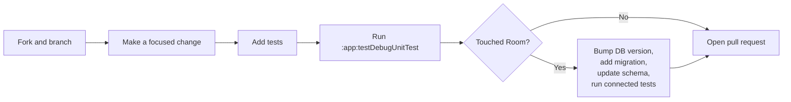

---

## License

No license file is currently included in this repository. Add a `LICENSE` file before redistributing the project under an open-source license.

---

<div align="center">

Built by **Byte-Harvest** 🌾

</div>
