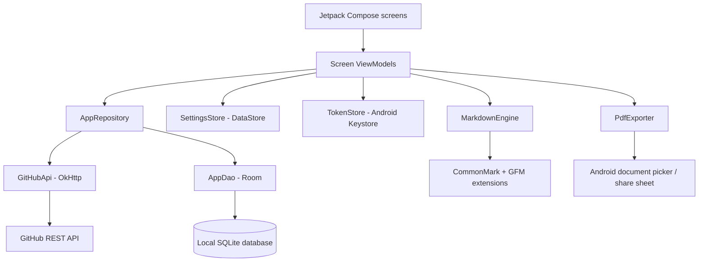

# Gitread.me

Gitread.me is a native Android app for reading Markdown documents from GitHub repositories or from files on your device. It combines a repository browser with a focused, customizable Markdown reader, and can keep repository documents on-device for offline reading.

## Contents

- [Features](#features)
- [How it works](#how-it-works)
- [Architecture](#architecture)
- [Technology](#technology)
- [Requirements](#requirements)
- [Build and run](#build-and-run)
- [Tests](#tests)
- [Use the app](#use-the-app)
- [GitHub access and privacy](#github-access-and-privacy)
- [Local storage and data model](#local-storage-and-data-model)
- [Project structure](#project-structure)
- [Known limitations](#known-limitations)
- [Contributing](#contributing)

## Features

### Find and open documents

- Open a public repository by entering `owner/repository`, pasting a GitHub URL, or using a supported GitHub SSH URL.
- Open a repository, branch, folder, or Markdown file from a GitHub `tree` or `blob` URL.
- When signed in, browse repositories available to the authenticated GitHub account.
- Browse Markdown files in folders, filter paths by name, switch branches, and manually refresh repository data.
- Open a local `.md` file through Android's document picker. The app copies the selected file into its private app storage before displaying it.
- See recently opened GitHub and local documents on the home screen.

### Read Markdown

- Render headings, paragraphs, emphasis, links, images, fenced and indented code, block quotes, ordered and unordered lists, thematic breaks, and tables.
- Support GitHub-Flavored Markdown tables, strikethrough, task lists, and autolinks.
- Use a centered, readable document column, serif reading typography, monospace code, syntax color accents, and horizontally scrollable code and tables.
- Choose light, dark, or app-following reader appearance independently of the app theme.
- Adjust reader font size from **12 sp to 28 sp**.
- Search case-insensitively, highlight matches, and move between results.
- Navigate using the table of contents or heading links.
- Bookmark GitHub documents, copy a code block or full Markdown source, and switch between rendered and raw Markdown.
- Export the rendered document to PDF or share a generated PDF.
- Restore the last reading position for each document.

### Keep repositories available offline

- From **Open from GitHub**, open a repository's three-dot menu and select **Make available offline**.
- Alternatively, use the download action in **Settings → Manage saved repositories**.
- The app downloads Markdown documents listed in the repository's saved tree, showing progress and a completion summary.
- Open **Bookmarks → Offline repos** to see repositories whose current Markdown file list is fully cached.
- Open cached documents without a network connection. Refresh repositories manually when online to discover changes.

Offline availability covers Markdown document text only. It does not download repository assets or guarantee that remote images, external links, or PDFs will work without a connection.

### Settings and backup

- Set the app theme to system, light, or dark.
- Set the reader appearance to follow the app, light, or dark.
- Adjust the persistent reader font size.
- Sign in with a GitHub fine-grained personal access token to access private repositories and increase API rate limits.
- Export or import a JSON backup containing the app theme, reader appearance, font size, and bookmarks.

Backups intentionally exclude access tokens, cached documents, local-file bookmarks, repository contents, and reading positions. To restore GitHub bookmarks, first save the corresponding repositories and branches on the destination device; import adds bookmarks for repositories it can match.

## How it works

### Opening and browsing a GitHub repository

1. The repository input parser validates the owner/repository and extracts an optional branch and path from supported GitHub URLs.
2. The app requests repository metadata and its recursive Git tree from the GitHub REST API.
3. Markdown paths (`.md` and `.markdown`, case-insensitive) and their blob SHAs are saved locally for that repository and branch.
4. The browser builds folder listings from this flat path list. Filtering searches the saved Markdown paths without another network request.
5. Selecting a file opens the reader. If a cached document has the same SHA as the saved tree, it can be read locally. Otherwise the app fetches the document from GitHub and caches it when it is within the cache limit.

### Refreshing and offline downloads

- **Refresh** fetches a new repository tree. The tree is updated transactionally; files no longer present are removed from the local tree and document cache.
- Documents already cached whose blob SHA changed are fetched again. If an update fails, the previous copy is retained.
- **Make available offline** compares each saved tree entry with the cached document SHA, downloads missing or outdated files, and reports files that could not be cached.
- Documents larger than **1,000,000 characters** can be displayed but are not stored in the Room document cache.
- Downloads run while the screen's ViewModel is alive. They are not scheduled as background work and may stop if Android kills the app or the screen process.
- The **Offline repos** list includes a repository only when it has at least one Markdown document and every Markdown file in its saved tree has a cached document with a matching SHA. A partial download is therefore not presented as fully offline-ready.

For the freshest offline copy, refresh the repository while online and then run **Make available offline**. A refresh can update the saved tree even if fetching one of the changed documents fails; the older cached copy is retained but no longer counts as current for the Offline repos list.

### Reading and saved position

- GitHub documents are parsed off the UI thread, then rendered as a lazy list of Markdown blocks.
- Search highlights matches and scrolls to the matching block.
- The table of contents and same-document heading links scroll to the corresponding heading.
- Scroll position is saved per repository/document (or local file) in Android DataStore and restored the next time it is opened.
- Local `.md` files are copied to the app's private `files/local_docs` directory before opening. They appear in recent documents and can be bookmarked on this device. Local file bookmarks are excluded from backups because their app-private paths are not portable to another device.

### Authentication flow

1. The user submits a fine-grained personal access token in Settings.
2. The app validates it with GitHub and stores the token encrypted with AES-256-GCM. The encryption key is held by Android Keystore; the account login is stored separately as non-secret metadata.
3. Authenticated API requests use the token to access GitHub. The app does not send the token to a separate application server.
4. Signing out clears the token and deletes saved private repositories, which also removes their cached documents, bookmarks, and history through Room's foreign-key cascade.

Use the narrowest token permissions possible: **Contents: read-only** and **Metadata: read-only**, restricted to the repositories you need. Never put a personal token in source code or a bug report.

## Architecture



### Responsibilities

- **Compose UI** (`ui/`): screens, interaction state, navigation, and Markdown presentation.
- **ViewModels**: screen-level state and coroutine work; they coordinate UI events with the repository or settings.
- **`AppRepository`**: GitHub repository lifecycle, cache policy, synchronization, bookmarks, history, and authentication state.
- **`GitHubApi`**: read-only GitHub REST operations using OkHttp and Kotlin serialization.
- **Room (`AppDatabase`, `AppDao`)**: persistent repository metadata, Markdown tree, cached text, bookmarks, and reading history.
- **`SettingsStore`**: theme, reader appearance, font size, and scroll positions using Preferences DataStore.
- **`TokenStore`**: encrypted token storage using Android Keystore and AES/GCM.
- **`MarkdownEngine`**: parser abstraction; `CommonmarkEngine` converts CommonMark/GFM nodes into UI-independent Markdown models.
- **Reader UI**: turns Markdown models into Compose blocks and resolves links, images, search, and table-of-contents navigation.
- **`PdfExporter`**: paginates a Markdown model into a local PDF using Android's `PdfDocument` APIs.
- **`AppContainer`**: small manual dependency-injection container created by the `Application` class; no DI framework is used.

### Data and cache model

Room stores these main tables:

| Table | Purpose |
|---|---|
| `repositories` | Owner, repository, branch, privacy flag, timestamps, and sync status. |
| `tree_entries` | Markdown file paths and Git blob SHAs for a repository branch. |
| `cached_documents` | Raw Markdown text and the SHA it was fetched for. |
| `bookmarks` | Bookmarked GitHub and local documents. |
| `reading_history` | Recently opened GitHub and local documents. |

A repository ID is the lowercased `owner/repository` plus `@branch`, so branches are cached independently. Tree entries, documents, bookmarks, and history refer to the repository with cascading foreign keys.

The local database is schema version 1. Schema changes must increment the Room database version and add a non-destructive migration; the app does not enable destructive migration fallback.

## Technology

- Kotlin **2.0.20**, Android Gradle Plugin **8.10.0**, Gradle **8.11.1**
- Jetpack Compose and Material 3; Compose BOM **2024.09.00**
- AndroidX Navigation Compose, Lifecycle ViewModel/StateFlow, and Kotlin Coroutines
- Room **2.6.1** with KSP; Preferences DataStore **1.1.1**
- OkHttp **4.12.0** and Kotlin serialization JSON **1.7.2**
- CommonMark **0.21.0** with GFM tables, strikethrough, task lists, and autolinks
- Coil **2.7.0** with SVG decoding
- Android `PdfDocument` for PDF export

Android configuration: **min SDK 26**, **target SDK 36**, **compile SDK 36**, Java/Kotlin bytecode target **17**, app version **1.0.0**.

## Requirements

- Android Studio with Android SDK Platform 36 and Build Tools 35.0.0 or newer installed.
- JDK 17 or newer. Gradle itself must run on JDK 17 or newer; the app's Java/Kotlin bytecode target remains 17.
- Gradle 8.11.1 if building from a terminal before the Gradle wrapper has been generated.
- An Android device or emulator for running the app. A connected device/emulator is also required for instrumentation tests.

The repository currently does not include `gradlew` / `gradlew.bat`. Android Studio can use its configured Gradle installation. To generate a wrapper locally, install Gradle 8.11.1 and run this from the repository root:

```powershell
gradle wrapper --gradle-version 8.11.1
```

After generating the wrapper, use `.\gradlew.bat` on Windows or `./gradlew` on macOS/Linux.

## Build and run

### Android Studio

1. Open the repository root in Android Studio.
2. Set Gradle JDK to JDK 17 or newer and install Android SDK Platform 36 if prompted.
3. Sync the project.
4. Select the `app` run configuration and an Android 8.0 (API 26) or newer device/emulator, then run.

### Command line

After generating the Gradle wrapper:

```powershell
# Windows PowerShell
.\gradlew.bat :app:assembleDebug
.\gradlew.bat :app:installDebug
```

```sh
# macOS / Linux
./gradlew :app:assembleDebug
./gradlew :app:installDebug
```

The debug APK is written under `app/build/outputs/apk/debug/`.

### Release builds

Release builds enable code minification and resource shrinking. The repository does not contain a release keystore or release signing configuration. Configure signing locally using private Gradle properties or environment variables before distributing a release. Do not commit keystores, passwords, or signing secrets.

## Tests

Run JVM unit tests:

```powershell
.\gradlew.bat :app:testDebugUnitTest
```

Run Android instrumentation tests on a connected device/emulator:

```powershell
.\gradlew.bat :app:connectedDebugAndroidTest
```

Current tests cover:

- Markdown parsing, GFM tables/task lists, heading anchors, fenced code language, and search matching.
- Repository input parsing, including supported GitHub URL targets.
- Relative-link resolution and Markdown path listing/filtering.
- Room cache isolation, upsert behavior, and cascading repository deletion.

## Use the app

### Open GitHub content

1. Tap the GitHub icon on the home screen.
2. Paste a repository URL or enter `owner/repository`, or choose a repository shown in **Your repos** after signing in.
3. Browse folders and Markdown files. Use the search icon to filter the saved file list.
4. Use the repository menu to switch branches or refresh its saved tree.
5. Open a file to read it. Its contents are cached automatically when the document is within the cache-size limit.

Supported input examples:

```text
octocat/Hello-World
https://github.com/octocat/Hello-World
https://github.com/octocat/Hello-World/tree/main/docs
https://github.com/octocat/Hello-World/blob/main/README.md
git@github.com:octocat/Hello-World.git
```

Branch names containing `/` cannot always be distinguished from a path in a pasted `tree` or `blob` URL. Open the repository and switch branches in the app when the URL cannot be parsed unambiguously.

### Make a repository available offline

1. Open **Open from GitHub** and find the repository in **Your repos**.
2. Tap its three-dot menu and choose **Make available offline**.
3. Keep the app open while it downloads. The row shows progress; a message reports downloaded, already cached, and unavailable files.
4. Open **Bookmarks → Offline repos** to see repositories whose full current Markdown list is cached.

The same download action is available in **Settings → Manage saved repositories**. Repository tree metadata must already be saved; opening a repository from GitHub creates that saved metadata.

### Read and export a document

- Use the reader toolbar for search, table of contents, and bookmarking.
- Open **More options** for raw/rendered view, copy Markdown, font-size adjustments, refresh, PDF export/share, and opening the document on GitHub.
- Set app and reader appearance in Settings. The reader defaults to dark appearance; font size defaults to 16 sp.
- Local `.md` files can be opened from the home screen. They are copied into app-private storage, appear in recent documents, and can be bookmarked on this device.

## GitHub access and privacy

- Public repository browsing does not require sign-in, subject to GitHub's unauthenticated API rate limits.
- Private repositories require a fine-grained personal access token with read-only Contents and Metadata permissions.
- The token is encrypted using AES-256-GCM; its key is stored in Android Keystore. The token is not included in exported backups.
- GitHub API calls go directly from the app to `api.github.com`; the app has no separate backend.
- Markdown images may reference GitHub or external URLs. Those images are fetched from their source host when rendered and are not included in the repository's offline document cache.
- The manifest disables Android's automatic app-data backup. Use the app's explicit JSON backup for the supported settings and bookmarks instead.
- Signing out clears the token and deletes locally saved private repositories and their dependent cache/bookmark/history data.

## Local storage and data model

- **Room database** (`mdreader.db`): repository metadata, tree, cached Markdown, GitHub bookmarks, and GitHub reading history.
- **Preferences DataStore** (`settings`): app theme, reader appearance, font size, and per-document reading position.
- **Auth preferences**: encrypted token ciphertext and IV plus the non-secret GitHub login; the encryption key is in Android Keystore.
- **Local documents**: copied to `files/local_docs/` in app-private storage.
- **Backup JSON**: created at a location chosen through Android's document picker; it contains only theme, reader appearance, font size, and bookmark records.

Removing a saved repository deletes its cached documents, bookmarks, and reading history on this device. It does not modify anything on GitHub.

## Project structure

```text
.
├── app/
│   ├── schemas/                         # Exported Room schema
│   └── src/
│       ├── main/
│       │   ├── java/com/byteharvest/mdreader/
│       │   │   ├── core/                # Parser, Markdown engine, PDF, token store
│       │   │   ├── data/                # Room, DataStore, GitHub API, repository
│       │   │   ├── domain/              # Path listing, filtering, and link resolution
│       │   │   └── ui/                  # Compose screens, ViewModels, theme, navigation
│       │   └── res/                     # App resources and adaptive launcher icon
│       ├── test/                        # JVM unit tests
│       └── androidTest/                 # Instrumented Android tests
├── docs/assets/                         # Original launcher-icon source artwork
├── build.gradle.kts                     # Root plugin versions
├── settings.gradle.kts                  # Project name and modules
└── README.md
```

## Known limitations

- Repository browsing is limited to GitHub and Markdown files (`.md`, `.markdown`); the app does not clone Git repositories.
- GitHub's recursive tree API can truncate very large repository listings. The app reports partial tree sync status, but missing paths cannot be browsed or downloaded from that response.
- Documents over 1,000,000 characters are displayed but not stored in the Room cache.
- Offline mode caches Markdown text only. Images, external links, and other assets are not downloaded for offline use.
- Repository refresh and offline download are manual foreground actions; there is no scheduled background sync.
- Raw HTML is not rendered as a browser would render it. `` tags are recognized; other HTML is reduced to text.
- Code colorization is lightweight token coloring, not a full language-aware syntax highlighter.
- Linked Markdown documents open in the reader, but their `#anchor` fragment is not carried through to the destination document.
- PDF output is a simplified text-oriented export: inline bold/italic/link styling is not preserved, images become `[image: alt]` text, and tables become text rows.
- Local-file image references are not resolved relative to the selected local Markdown file.
- GitHub authentication uses a user-provided personal access token. OAuth is not implemented.

## Contributing

1. Keep changes focused and follow the existing Kotlin/Compose patterns.
2. Add or update JVM tests for parser, path, link, and other platform-independent behavior.
3. Add instrumentation tests for Room or Android-specific behavior.
4. Run `:app:testDebugUnitTest` before submitting changes; run connected tests when changing Room behavior.
5. When changing Room entities, increment the database version, add a migration, and update the exported schema. Never add destructive migration fallback.
6. Never commit tokens, keystores, local SDK configuration, generated build outputs, or private credentials.

## License

No license file is currently included in this repository. Add a `LICENSE` file before redistributing the project under an open-source license.
